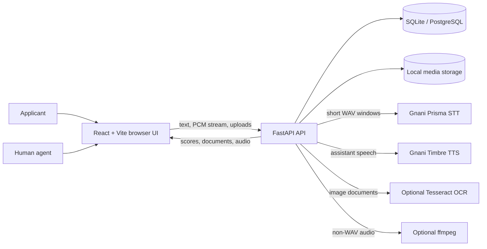
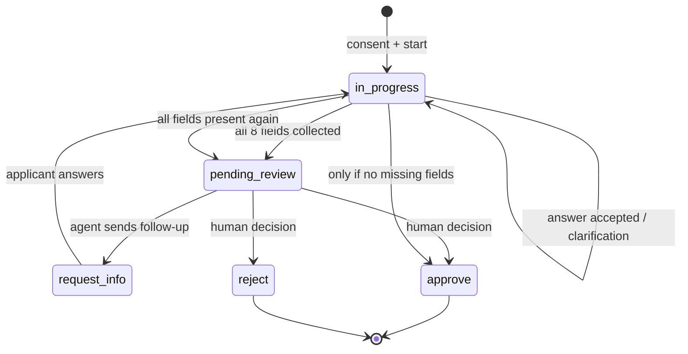
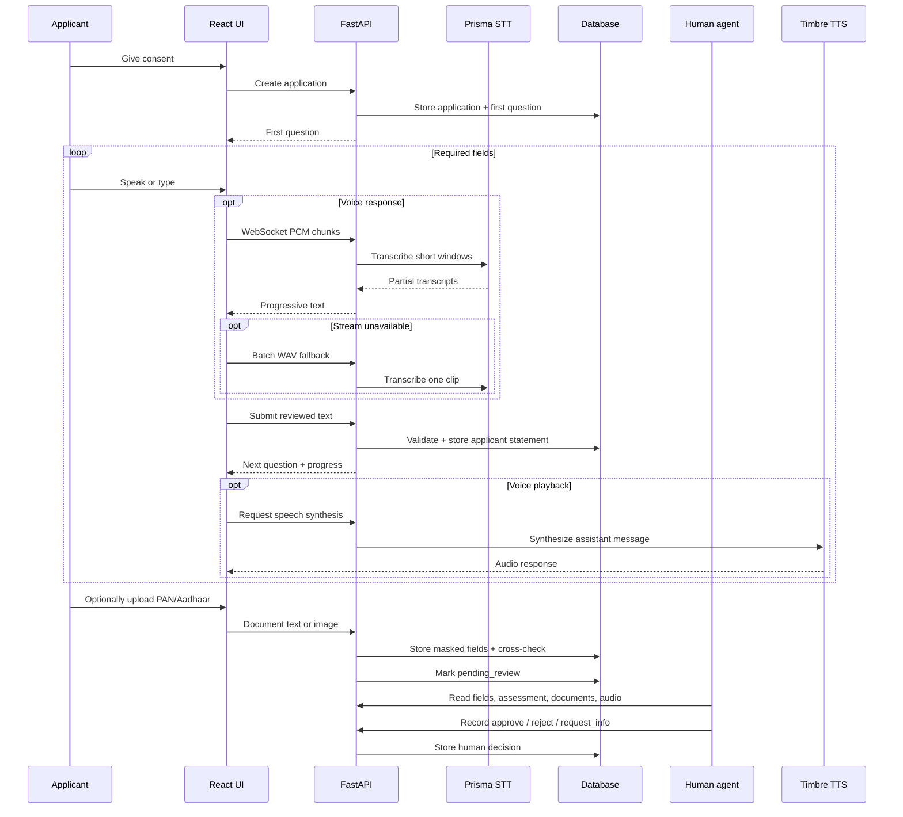
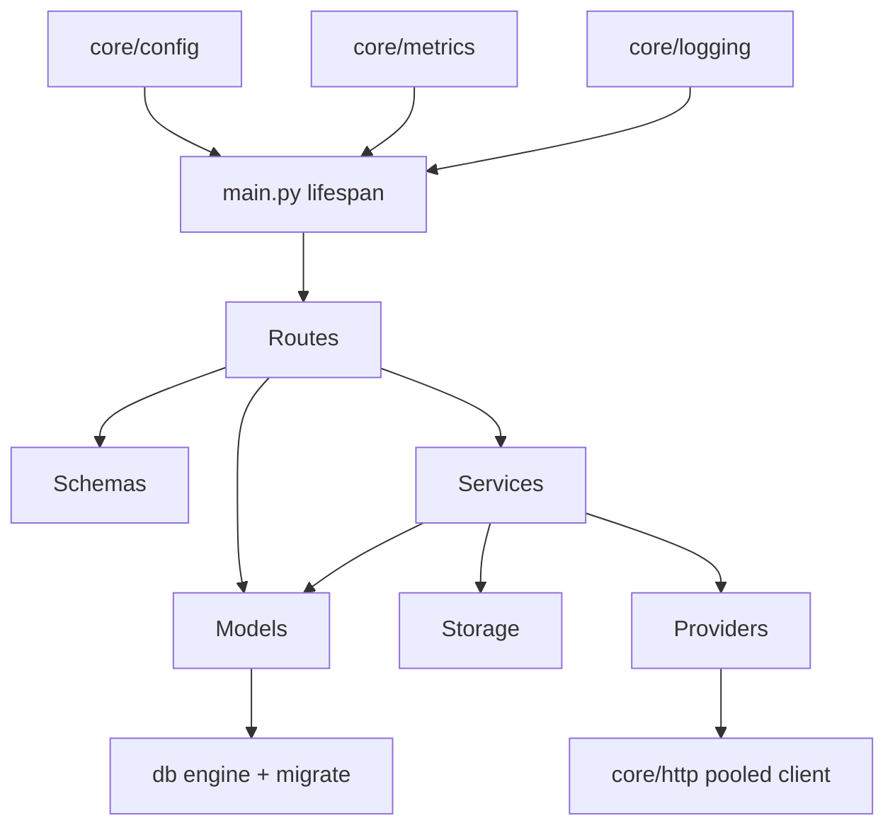
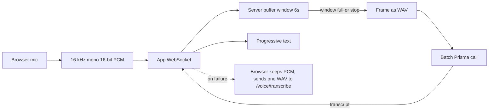

# VoiceKYC architecture

## Architecture diagrams

### System architecture

### Application state machine

### Applicant intake and review sequence

### Backend module dependency map

### Streaming STT windowing

## Runtime flow

1. Applicant explicitly consents and starts an application.
2. FastAPI creates a persistent application record (SQLite locally, PostgreSQL in Compose).
3. Applicant speaks or types. Typed text is submitted directly; speech is streamed as 16 kHz mono PCM over an app-level WebSocket and transcribed in short Prisma windows. If the stream fails, the browser sends one batch WAV instead.
4. The intake service validates only the current field. A deterministic framing-strip removes conversational lead-ins and keeps the applicant's untouched utterance as a fallback candidate. The result still passes through the same syntax validators.
5. Accepted values are stored as applicant statements with `confidence: null`, `needs_review: true`, and the applicant's supporting words in `evidence`.
6. Optional PAN/Aadhaar text or image uploads are parsed, masked, and cross-checked against the spoken name and date of birth. A mismatch is a review flag, not a verification result.
7. Timbre can synthesize assistant messages when configured. The applicant can also type at any time.
8. When all eight required fields are present, the application moves to `pending_review`.
9. The agent cockpit loads the fields, evidence summary, documents, audio, and transcript. The agent can mark fields reviewed or flagged, generate/send a localised follow-up, and record `approve`, `request_info`, or `reject`.
10. Approve is blocked while required fields are missing. The decision is human-recorded; nothing here verifies identity or creditworthiness.

## Backend boundaries

- `api/routes`: HTTP/WebSocket transport and request handling.
  - `applications.py`: intake, idempotent messages, detail, field review, follow-up, assessment, decision.
  - `documents.py`: upload/list/delete and cross-check.
  - `audio.py`: direct upload, resumable chunks, playback, delete.
  - `voice.py`: batch STT/TTS plus the streaming WebSocket.
  - `health.py`, `ops.py`: capabilities and metrics.
- `schemas`: API input/output validation.
- `models`: SQLAlchemy persistence entities.
  - `Application`: status, language, `extracted`, `reviewed_fields`, stored `assessment`, decision.
  - `ConversationMessage`: transcript, channel, `client_message_id`.
  - `IdentityDocument`: masked fields, cross-check, extraction method, stored file.
  - `AudioUpload`: status, byte offsets, duration, stored file.
- `db`: database engine/session and idempotent startup column additions.
- `services/intake.py`: deterministic field syntax validation, prompts, clarification and follow-up templates.
- `services/extraction.py`: framing-strip candidates and clarification-attempt derivation.
- `services/documents.py`: PAN shape, Aadhaar Verhoeff, date/name comparison, cross-check result.
- `services/scorecard.py`: transparent rule-based evidence summary with reason codes.
- `services/audio.py`: PCM→WAV framing, 16 kHz mono normalisation, optional ffmpeg.
- `services/ocr.py`: optional Tesseract adapter with an honest no-OCR path.
- `services/storage.py`: safe generated file paths, append, read, delete.
- `services/providers.py`: isolated Gnani Prisma/Timbre HTTP adapters.
- `core/config.py`: environment-backed configuration.
- `core/http.py`: pooled shared client plus bounded retry/backoff.
- `core/metrics.py`: dependency-free in-process counters.
- `core/logging.py`: JSON logging and request correlation IDs.
- `main.py`: lifespan, shared client, schema evolution, CORS, metrics middleware, error handler, router wiring.

## Streaming design

The vendor streaming protocol is not part of the verified Gnani contract. Rather than guess it, the server exposes an app-level WebSocket:

- the browser downsamples microphone audio to 16 kHz mono 16-bit PCM;
- the server buffers `STREAM_WINDOW_SECONDS` windows;
- each window is framed as a valid WAV and sent to the batch Prisma endpoint;
- partial and final transcripts are pushed back as JSON;
- a hard buffer cap stays below Prisma's 30-second limit;
- if the socket cannot connect or the provider errors, the browser keeps the PCM and calls `/voice/transcribe` with one WAV at stop.

This is honest about what is and is not vendor-native streaming.

## LLM extraction (optional)

- Provider: Groq (free API), model `openai/gpt-oss-20b` (override via `GROQ_MODEL`).
- Module: `services/llm_extraction.py` calls Groq Chat Completions with `response_format: json_object` and a strict system prompt; falls back to plain mode if rejected.
- Wired into `applications.send_message`: rules run first as a candidate, then LLM over the full transcript + pending fields; LLM values take precedence only when they pass `validate_field`. Nothing is saved without validation.
- Soft-fail: any network/API/timeout/parse error returns `None` and the turn continues with rules only.
- Per-field `extraction_source` (`llm` / `rules`) is persisted and shown in the agent UI.
- Disabled by default (`LLM_PROVIDER=none`); no key means no call. Evon is not used.

## Data and file boundaries

- Uploaded bytes live under `STORAGE_DIR` with generated names; the database stores relative paths.
- Path resolution refuses traversal outside the storage root.
- PAN/Aadhaar numbers are stored masked for display, while the parsed document fields retain the extracted value for cross-checking.
- Deleting an application removes its database rows (cascade) and stored files.
- No encryption at rest or retention policy exists in this prototype.

## Low-bandwidth and retry design

- Applicant messages carry a client-generated `client_message_id`; a repeat returns the current state with `duplicate: true` and does not add a second turn.
- The browser outbox queues retryable failures in `localStorage` and flushes in order on reconnect and every 15 seconds.
- Resumable audio chunks require an exact offset; a stale retry returns `409` with the expected offset.
- Applicant and agent screens poll every 8 seconds, so follow-ups and new records appear without a manual refresh.

## Trust boundaries

- Applicant speech and documents are untrusted input.
- Transcription is not identity verification.
- Deterministic extraction is not ground truth; extracted values require human review.
- A document cross-check that reports `consistent` is not identity verification.
- The evidence summary is not a credit score and never approves or rejects.
- Confidence is intentionally unreported until calibrated against an evaluation dataset.
- The agent dashboard is not authenticated in this prototype; do not expose it publicly or store real applicant information.

## Deployment topology

- `frontend/Dockerfile`: multi-stage Node build, nginx runtime.
- `frontend/nginx.conf`: SPA fallback, `/api` reverse proxy, WebSocket upgrade headers, 25 MB upload cap.
- `backend/Dockerfile`: Python 3.11 slim, uploads volume at `/data/uploads`.
- `docker-compose.yml`: PostgreSQL 16 with health checks, backend, nginx frontend.
- `backend/migrations/`: Alembic environment for reviewed deployment migrations.
- `.github/workflows/ci.yml`: backend compile + tests, frontend `npm ci` + build.
