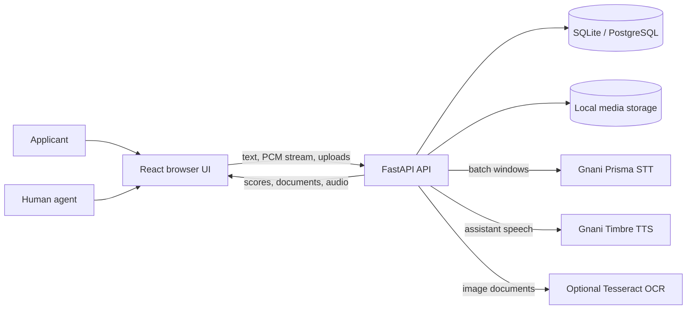
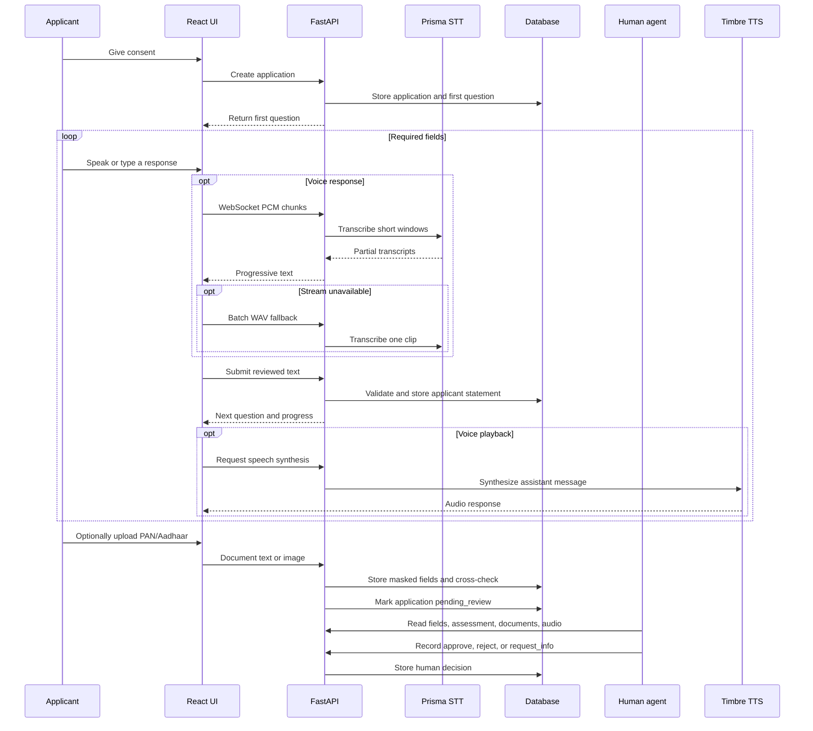
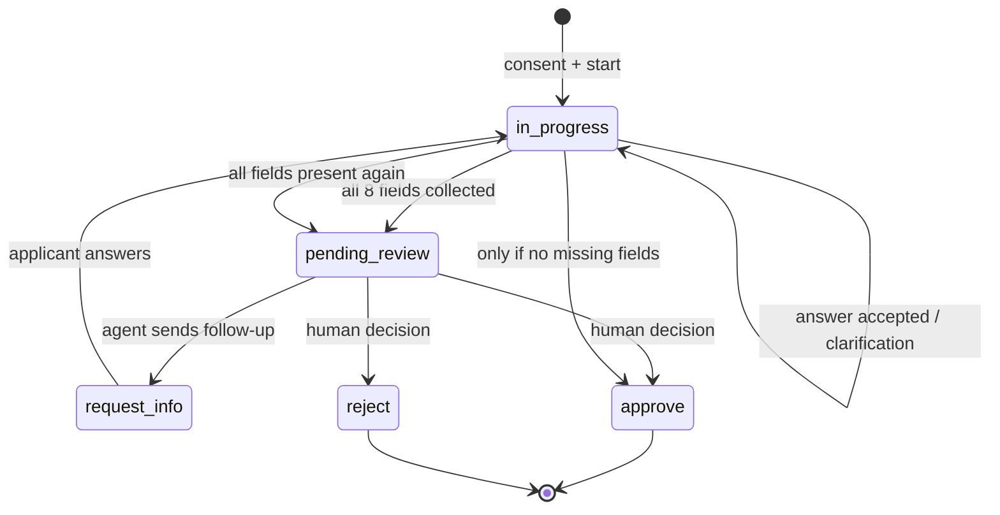

# VoiceKYC

**Asynchronous, voice-first KYC intake and assisted human review for microfinance.**

VoiceKYC is a multilingual applicant-intake prototype. Applicants provide onboarding information in Hinglish or Marathi by voice or text. The backend stores structured applicant statements, audio evidence, identity-document cross-checks, and a transcript. A human agent reviews the information and records the decision.

> **Scope and safety:** This is a prototype for information collection and assisted review. It does not independently verify identity, establish creditworthiness, or make an autonomous lending decision. Applicant statements and documents must be inspected by an authorized person. Do not use real financial or identity data in public demos.

## Current implementation

- React + Vite applicant interface and an agent review cockpit.
- FastAPI backend split into API routes, schemas, services, configuration, database and models.
- SQLite persistence for local development; PostgreSQL wired through Docker Compose and Alembic for deployment.
- Consent gate before a new application is created.
- Hinglish and Marathi field prompts.
- Sequential multi-turn intake with deterministic syntax validation.
- Conservative framing-strip extraction: it removes conversational lead-ins and always keeps the applicant's untouched words as a fallback. No confidence is fabricated and no value is invented.
- Escalating clarification: after a repeated unusable answer the reply includes a concrete per-field, per-language example.
- Live transcription over an app-level WebSocket: 16-bit mono PCM is buffered into short windows and transcribed with the batch Prisma endpoint, with a single-recording batch fallback.
- Resumable audio uploads with explicit chunk offsets and optional WAV normalisation (ffmpeg when available, stored-as-is otherwise).
- PAN format and Aadhaar Verhoeff validation, plus a name/date-of-birth cross-check against the applicant's spoken fields.
- Transparent, rule-based evidence summary with reason codes. Recommendations are limited to `standard_manual_review` and `priority_manual_review`.
- Separate agent field-review records so the applicant record keeps `needs_review: true`.
- Offline-tolerant applicant outbox on the device with idempotent `client_message_id` delivery.
- Polling so the applicant sees agent follow-ups and the agent sees new activity without a manual refresh.
- Bounded retries with exponential backoff and a pooled HTTP client for outbound provider calls.
- Structured JSON logs with request correlation IDs and an in-process `/metrics` snapshot for the ops floor.
- Docker images, Docker Compose with PostgreSQL, nginx reverse proxy/WebSocket forwarding, Alembic scaffolding, and GitHub Actions CI.
- 69 backend tests using an isolated in-memory SQLite database.

## Technology stack

| Area | Technologies |
|---|---|
| Frontend | React 18, Vite, Tailwind CSS, Lucide React |
| Backend | Python 3.11+, FastAPI, Uvicorn |
| Validation and configuration | Pydantic, Pydantic Settings |
| Persistence | SQLAlchemy 2, SQLite locally, PostgreSQL in Compose |
| Voice services | Gnani Prisma speech-to-text, Gnani Timbre text-to-speech |
| Live transcription | App-level WebSocket + windowed batch Prisma calls |
| API communication | REST/JSON, multipart uploads, WebSocket, HTTPX |
| Media | Browser/PCM ↔ WAV, optional ffmpeg and Tesseract |
| Testing and CI | Pytest, GitHub Actions |
| Deployment | Docker, Docker Compose, nginx, Alembic |

## Project structure

```text
voicekyc/
├── README.md
├── ARCHITECTURE.md
├── CHANGELOG.md
├── AGENTS.md
├── docker-compose.yml
├── .github/workflows/ci.yml
├── backend/
│   ├── Dockerfile
│   ├── alembic.ini
│   ├── migrations/            # Alembic env + revisions (deployment path)
│   ├── .env.example
│   ├── requirements.txt
│   ├── README.md
│   ├── app/
│   │   ├── main.py            # lifespan, CORS, metrics, routers, error handler
│   │   ├── api/routes/        # applications, documents, audio, voice, health, ops
│   │   ├── core/              # settings, pooled HTTP, retries, logging, metrics
│   │   ├── db/                # engine, base, startup schema evolution
│   │   ├── models/            # application, messages, documents, audio
│   │   ├── schemas/           # request/response validation
│   │   └── services/          # intake, extraction, documents, audio, OCR, scorecard
│   └── tests/
└── frontend/
    ├── Dockerfile
    ├── nginx.conf
    ├── .env.example
    ├── package.json
    ├── vite.config.js
    └── src/
        ├── api/               # API client (REST, uploads, WebSocket URL)
        ├── components/        # Applicant interface and agent cockpit
        ├── App.jsx
        ├── main.jsx
        └── index.css
```

## Architecture diagrams

### System architecture



### Applicant and review flow



### Application state machine



## Run locally

### Backend (Windows PowerShell)

```powershell
cd backend
py -3.11 -m venv .venv
.\.venv\Scripts\Activate.ps1
pip install -r requirements.txt
Copy-Item .env.example .env
uvicorn app.main:app --reload --port 8000
```

### Backend (macOS/Linux)

```bash
cd backend
python3 -m venv .venv
source .venv/bin/activate
pip install -r requirements.txt
cp .env.example .env
uvicorn app.main:app --reload --port 8000
```

### Frontend

In another terminal:

```bash
cd frontend
npm ci
cp .env.example .env   # Windows: Copy-Item .env.example .env
npm run dev
```

Open http://localhost:5173. API documentation is at http://localhost:8000/docs. Vite proxies `/api` (including the WebSocket upgrade) to `http://127.0.0.1:8000`.

## Configuration

Settings load the project-root `.env` and `backend/.env`; `backend/.env` wins when both define a key, and process environment variables win over both. Never commit a real key.

### Gnani speech services

The backend uses the documented Gnani Speech API contract:

| Capability | Endpoint | Contract |
|---|---|---|
| Prisma STT | `POST https://api.vachana.ai/stt/v3` | multipart: `audio_file`, `language_code`, optional `model=prisma-v3.0`, `format=transcribe` |
| Timbre TTS | `POST https://api.vachana.ai/api/v1/tts/inference` | JSON: `text`, `model`, `voice`, `language`, `audio_config` |
| Authentication | both | header `X-API-Key-ID` (same key for STT and TTS) |

Normally only the key is required:

```dotenv
GNANI_API_KEY=your_key_here
```

Optional overrides:

```dotenv
GNANI_API_BASE_URL=https://api.vachana.ai
GNANI_PRISMA_TRANSCRIBE_PATH=/stt/v3
GNANI_TIMBRE_SYNTHESIZE_PATH=/api/v1/tts/inference
GNANI_STT_MODEL=prisma-v3.0
GNANI_TTS_MODEL=timbre-v2.5
GNANI_TTS_VOICE=
GNANI_REQUEST_TIMEOUT_SECONDS=45
```

Without Gnani configuration, voice endpoints return `503` and the applicant can still type. Prisma returns a `transcript` string; Timbre returns audio bytes.

### Streaming transcription

`WS /api/v1/voice/stream?language=hinglish` accepts JSON control messages and binary PCM frames:

- `{"type": "start", "sampleRate": 16000}` → `{"type": "ready", ...}`
- Binary frames: 16-bit mono PCM.
- `{"type": "flush"}` → final transcript for the current window.
- `{"type": "stop"}` → remaining audio, then `{"type": "done", "text": "..."}`.

The server buffers windows of `STREAM_WINDOW_SECONDS` (default 6, hard cap below Prisma's 30-second limit) and calls the batch endpoint for each window. This is **app-level streaming**, not a verified vendor streaming protocol. If the socket fails, the browser keeps the PCM and sends one batch WAV to `/voice/transcribe`.

### Optional LLM extraction (Groq GPT-OSS)

Structured field extraction can optionally use Groq's free API with `openai/gpt-oss-20b` (or `openai/gpt-oss-120b`):

```dotenv
LLM_PROVIDER=groq
GROQ_API_KEY=your_groq_key_here
GROQ_MODEL=openai/gpt-oss-20b
GROQ_BASE_URL=https://api.groq.com/openai/v1
GROQ_REQUEST_TIMEOUT_SECONDS=20
```

- If `LLM_PROVIDER=none` (default) or `GROQ_API_KEY` is missing, Groq is never called; the deterministic rules extractor is used.
- The LLM is given the full transcript and the pending field keys and returns JSON. Every candidate value is still run through the existing validators (`validate_field`) before being saved.
- On network/API errors, timeouts, or invalid JSON, the turn falls back to rules extraction; the request does not crash.
- `extraction_source` (`llm` / `rules`) is stored per field and shown as a badge in the agent dashboard.
- Speech (Prisma STT / Timbre TTS) is unaffected. No auto-approve: agents still record Approve / Reject / Request more info.
- No fabricated confidence: extracted values keep `confidence: null`, `needs_review: true`.

### Storage, uploads and OCR

```dotenv
STORAGE_DIR=./data/uploads
MAX_AUDIO_UPLOAD_MB=15
MAX_DOCUMENT_UPLOAD_MB=10
STREAM_WINDOW_SECONDS=6
STREAM_MAX_BUFFER_SECONDS=25
TESSERACT_CMD=tesseract
```

- Audio and documents are written under `STORAGE_DIR`; the database stores relative paths and deletes files with the application.
- WAV input is normalised to 16 kHz mono 16-bit with the standard library. Non-WAV input is converted with ffmpeg when available; otherwise it is stored unchanged and labelled `stored_as_is`.
- Image OCR uses Tesseract when available. Otherwise the document endpoint accepts applicant-supplied text and labels the method `applicant_supplied_text` or `plain_text_file`.

### Reliability and observability

```dotenv
LOG_LEVEL=INFO
PROVIDER_RETRY_ATTEMPTS=3
PROVIDER_RETRY_BASE_DELAY_SECONDS=0.5
```

- Prisma and Timbre calls retry transient network failures and `429`/`5xx` responses with exponential backoff.
- One pooled `httpx.AsyncClient` is created in the application lifespan.
- Every request gets an `X-Request-ID` (incoming IDs are preserved) and emits one JSON log line with method, path, status and duration.
- Provider calls log provider name, status code and latency — never credentials or transcript text.
- `GET /api/v1/metrics` returns process-local request/provider counters, application counts by status, uptime and storage usage. It is unauthenticated like the rest of the prototype API.

## How an answer becomes one field

Extraction is deterministic and conservative:

1. The framing-strip extractor removes conversational lead-ins (`"mera naam … hai"` → `"Ramesh Kumar"`, `"main kheti karta hoon"` → `"kheti"`, `"main … mein rehta hoon"` → the address).
2. Candidates are tried in order through the deterministic validators. The applicant's untouched utterance is always the last candidate, so a bad rewrite can only be less specific than what was said.
3. An accepted value is stored as an applicant statement with `confidence: null`, `confidence_type: "not_assessed"`, `source: "applicant_statement"`, and `needs_review: true`.
4. If no candidate validates, the same field is re-asked. After a repeated failure the reply adds an example for that field and language.
5. A typed answer is preserved in the input box if a request fails.

There is no semantic LLM extraction path in this repository.

## Document cross-check and evidence summary

`POST /applications/{id}/documents` accepts `doc_type=pan|aadhaar` plus either `text` or a file.

- PAN is checked for the canonical printed shape (`AAAAA9999A`).
- Aadhaar is checked for 12 digits, a valid first digit and the Verhoeff checksum.
- Names are compared token-wise; a shared surname alone is not a match, and the given name must agree in a common name order.
- Dates of birth are parsed and compared.
- Results are `consistent`, `inconsistent`, or `not_checked`. An `inconsistent` result raises a review flag; it is never described as identity verification.

`GET /applications/{id}/assessment` returns a transparent rule-based summary:

- completion, stated income band, occupation clarity, loan purpose and phone presence;
- document consistency or mismatch;
- every point is tied to a reason code;
- recommendations are only `standard_manual_review` or `priority_manual_review`.

This is **not** a credit score, an underwriting model, or an approval.

## Low-bandwidth behaviour

- The applicant outbox stores unsent answers in `localStorage` and retries them on reconnect and every 15 seconds.
- Each answer carries a `client_message_id`; the server ignores a repeat, so retries are at-most-once.
- While queued answers exist, new answers join the queue to preserve order.
- Audio can be uploaded in offset-checked chunks (`/audio/init`, `/chunk`, `/complete`) and resumed after a dropped connection.
- The applicant and agent screens poll every 8 seconds, so agent follow-ups reach the applicant without a manual refresh.
- Live transcription degrades to typing or to one batch recording if the WebSocket or provider is unavailable.

## Docker deployment

```bash
# From the repo root. The gitignored root .env can supply GNANI_API_KEY.
docker compose up --build
```

- `frontend` (nginx) serves the built SPA on http://localhost:8080 and proxies `/api` plus WebSocket upgrades to `backend:8000`.
- `backend` uses PostgreSQL (`db:5432`) and a named uploads volume.
- `db` is PostgreSQL 16 with a health check; both app services wait for dependencies.
- Compose environment defaults are development-only. Change `POSTGRES_PASSWORD`, `SECRET_KEY`, and CORS origins before any shared deployment.

The local prototype database evolves through idempotent `ALTER TABLE` additions at startup (`app/db/migrate.py`). For PostgreSQL deployments, create an initial Alembic revision from `backend/`:

```bash
alembic revision --autogenerate -m "initial schema"
alembic upgrade head
```

Review generated revisions before committing them.

## Tests

```bash
cd backend
pytest
```

The suite covers intake validators, extraction, audio framing/normalisation, PAN/Aadhaar checks, document cross-checks, the evidence summary, resumable uploads, the streaming WebSocket, idempotent messages, field review, follow-ups, capabilities, and metrics. API tests use an isolated in-memory SQLite database and `tmp_path` storage, and override `get_db`, so they never touch `backend/voicekyc.db`.

CI runs `python -m compileall`, `pytest`, `npm ci`, and `npm run build`.

## API summary

All routes are under `/api/v1`.

| Method | Path | Purpose |
|---|---|---|
| `GET` | `/health`, `/capabilities` | Liveness and configured capabilities |
| `GET` | `/metrics` | In-process ops snapshot |
| `POST` | `/applications` | Start an application (consent required) |
| `POST` | `/applications/{id}/messages` | Submit an answer (optional `client_message_id`) |
| `GET` | `/applications`, `/applications/{id}` | List and detail |
| `POST` | `/applications/{id}/decision` | Human decision |
| `GET` | `/applications/{id}/assessment` | Rule-based evidence summary |
| `POST` | `/applications/{id}/fields/{field}/review` | Agent field review |
| `POST` | `/applications/{id}/follow-up` | Generate/send an agent question |
| `POST`/`GET`/`DELETE` | `/applications/{id}/documents...` | Upload, list, delete documents |
| `POST`/`GET`/`DELETE` | `/applications/{id}/audio...` | Direct, resumable, playback, delete |
| `POST` | `/voice/transcribe`, `/voice/synthesize` | Batch STT and TTS |
| `WS` | `/voice/stream` | Progressive PCM transcription |

## Known limitations

- **No semantic LLM extraction.** The deterministic extractor cannot reliably split a long multi-fact answer, resolve ambiguous references, or answer open-ended follow-ups.
- **Streaming is app-level.** It windows audio into batch Prisma calls; the vendor's native streaming contract is not verified.
- Prisma batch transcription is limited to 30-second clips. The browser auto-stops at 29 seconds; streaming windows keep each provider call below that limit.
- **Cross-check is not verification.** A `consistent` result only means the supplied text agrees with the spoken fields. There is no liveness check, government API lookup, forgery detection, or document-image authenticity check.
- **The evidence summary is not a credit score.** It ranks how much reviewable evidence exists and never approves or rejects.
- OCR and ffmpeg are optional. They are not installed in the default Docker image or required by tests; without them the API labels the fallback honestly.
- SQLite is for local prototyping. PostgreSQL is wired for Compose, but an initial Alembic revision must be generated and reviewed before a production deployment.
- The agent API/dashboard has no authentication or authorization. Do not expose it publicly with real applicant data.
- Stored audio/documents are protected only by filesystem permissions. There is no encryption at rest, retention policy, or consent revocation workflow.
- The offline outbox is device-local `localStorage`; do not use shared devices with real applicant data.
- There is no background job queue; transcription and checks run inline.
- Field validation checks syntax and completeness, not the truth of applicant responses.
- Confidence remains unassessed (`null`) rather than showing fabricated scores.
